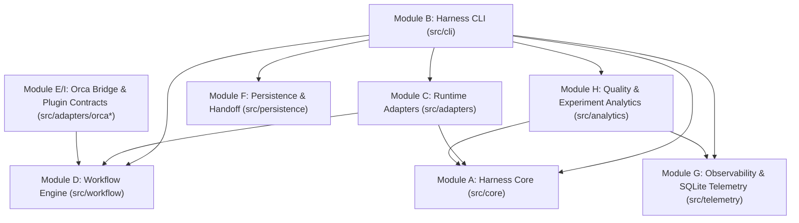

# Delamain (`dlm`) Architecture

Delamain (`dlm` / `delamain`) is a modular, runtime-independent AI Development Harness engineered to coordinate, validate, instrument, and persist software development workflows across **Claude Code**, **OpenAI Codex CLI**, **Google Antigravity (`agy`)**, and **Orca Orchestration**.

## 1. Architectural Principles

1. **Zero Lock-in & Native Runtime Preservation**: Delamain never replaces the native agent loop or OS sandbox of Claude Code, Codex, or Antigravity. Instead, it compiles canonical project configuration (`.agents/harness.yaml`) into each runtime's native mechanisms (`AGENTS.md`, `CLAUDE.md`, `.agents/skills/`, `.claude/skills/`, `.claude/settings.json`, `.codex/hooks.json`, `.codex/config.toml`, `.agents/hooks.json`).
2. **Small Interfaces & Dependency Inversion**: Modules depend strictly inward on narrow domain contracts (`src/core/types.ts`).
3. **Verifiable Contracts Over Prose**: Manifests, lockfiles, workflows, handoffs, and telemetry events are validated against strict JSON Schemas (`schemas/*.schema.json`) and cryptographic SHA-256 checksums.
4. **No Duplicate Scheduler**: When Orca is reachable, Delamain compiles its validated workflow DAG waves directly into `orca orchestration` commands (`run-create`, `task-create --deps`, `worker-start`, `gate-create`, `check --wait`). When Orca is absent, `dlm` operates standalone for installation, validation, handoffs, and stage execution.

## 2. Module Topology



### Module Responsibilities

| Module | Path | Responsibility |
| :--- | :--- | :--- |
| **A. Harness Core** | `src/core/` | Manifest (`harness.yaml`), lockfile (`harness.lock`), JSON Schema validator, catalog discovery, path-traversal/command/secret security guards, backup/rollback manager, and idempotent installer. |
| **B. Harness CLI** | `src/cli/` | `dlm` / `delamain` executable supporting human-readable and `--json` output across `init`, `sync`, `doctor`, `validate`, `upgrade`, `workflow`, `handoff`, `session`, and `analytics`. |
| **C. Runtime Adapters** | `src/adapters/` | Capability detection separating `declared`, `detected`, and `verified` support for `claude-code`, `codex`, and `agy`; non-destructive config synchronization and security auditing. |
| **D. Workflow Engine** | `src/workflow/` | Declarative DAG parser, cycle detector, dependency reconciler for disabled stages, mandatory gate protector, topological parallel wave planner, and explicit stage state machine. |
| **E. Orchestration Integration** | `src/adapters/orca.ts` | Inspects `orca status --json` and compiles validated `WorkflowExecutionPlan` waves into `orca orchestration` commands. |
| **F. Persistence & Handoff** | `src/persistence/` | Versioned cross-runtime handoff contract (`handoff.schema.json`) with active git branch/commit/file-hash verification (`dlm handoff verify` / `consume`) and `.ai-harness-state/progress.json`. |
| **G. Observability & Telemetry** | `src/telemetry/` | Runtime-agnostic 23-event schema stored in local WAL-mode SQLite (`node:sqlite`), trace/span correlation, event deduplication, hook ingestion, and 4-tier skill observability (`available`, `loaded`, `invoked`, `verifiedProcedures`). |
| **H. Analytics & Quality** | `src/analytics/` | Metric provenance tracking (`measured`, `estimated`, `derived`, `unavailable`), TypeScript & .NET quality collectors, session reports, and multi-cohort experiment comparisons with statistical sample-size caveats. |
| **I. Orca Visual Contracts** | `src/adapters/orca-plugin-contracts.ts` | Shared TypeScript view-model contracts for future Orca panels (Workflow Editor, Stage Timeline, Agent Execution Tree, Skills Inspector, Session Analytics, Model Usage, Experiment Comparison, Harness Manager). |

## 3. Consumer Project Layout

When `dlm init` and `dlm sync` run inside a consumer repository, they produce:

```text
consumer-repo/
├── .agents/
│   ├── harness.yaml          # Versioned project configuration (developer-editable)
│   ├── harness.lock          # Deterministic lockfile with SHA-256 checksums (generated)
│   ├── hooks.json            # Antigravity (agy) lifecycle hooks
│   ├── hooks/
│   │   └── dlm-hook.mjs      # Portable runtime hook script
│   ├── workflows/            # Project workflows (feature.yaml, bugfix.yaml, ...)
│   ├── skills/               # Canonical shared skills (<name>/SKILL.md)
│   └── rules/                # Project & stack rules
├── .claude/
│   ├── settings.json         # Claude Code hooks & safe settings (merged non-destructively)
│   └── skills/               # Synced skills for Claude Code discovery
├── .codex/
│   ├── config.toml           # Codex safe sandbox defaults (preserved if user-edited)
│   └── hooks.json            # Codex lifecycle hooks
├── .ai-harness-state/        # Gitignored local state, SQLite telemetry, handoffs, backups
├── AGENTS.md                 # Merged via <!-- dlm:managed:start/end --> markers
└── CLAUDE.md                 # Merged via <!-- dlm:managed:start/end --> markers
```
